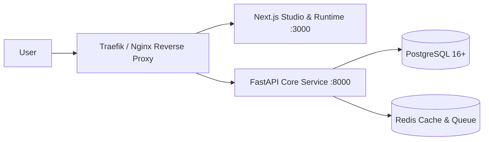

# MiniForge Deployment Guide

MiniForge is designed to run in modern containerized cloud environments (AWS ECS/EKS, GCP Cloud Run/GKE, DigitalOcean, Railway, or VPS with Docker Compose).

---

## 1. Production Docker Architecture

MiniForge comprises 4 coordinated services:



---

## 2. Environment Configuration Matrix

| Variable | Scope | Purpose |
| :--- | :--- | :--- |
| `DATABASE_URL` | Backend | PostgreSQL connection string (`postgresql+asyncpg://...`) |
| `REDIS_URL` | Backend | Redis connection string (`redis://redis:6379/0`) |
| `SECRET_KEY` | Backend | 32-byte secret for JWT signing and session validation |
| `ENCRYPTION_MASTER_KEY` | Backend | 32-byte base64 AES key for encrypting Telegram bot tokens |
| `NEXT_PUBLIC_API_URL` | Frontend | Base endpoint for API requests (`https://api.miniforge.app`) |
| `NEXT_PUBLIC_APP_DOMAIN`| Frontend | Domain for standalone published apps |

---

## 3. Docker Compose Local & Production Deploy

Launch the full platform stack with a single command:

```bash
docker compose -f infrastructure/docker/docker-compose.yml up -d
```
